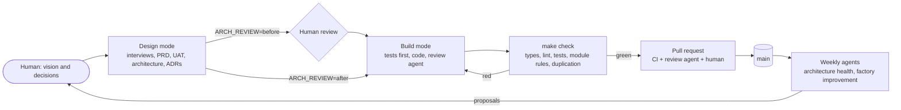

# Dark / grey Software Factory: how it works

These pages are shared by every dsf-* repo and every application cloned from one. They come from dsf-base; improve them there (or contribute changes back with `make contribute`).

| Page | Read it when |
| --- | --- |
| [setup.md](setup.md) | You install the tools, start a new application, or turn on the GitHub agents. |
| [usage.md](usage.md) | You want the big picture: the three repo levels, modes, and how improvements flow back. |
| [workflows.md](workflows.md) | You start a piece of work: bugfix, feature, exploration or factory change. |
| [hooks.md](hooks.md) | You want to know what the loops, Claude Code hooks and git hooks do, and why. |
| [architecture-health.md](architecture-health.md) | You read a health report or define modules. |
| [review.md](review.md) | You review agent work: code, architecture, proposals. |
| [tasks.md](tasks.md) | You choose or use a task backend. |
| [factory-evolution.md](factory-evolution.md) | You want the factory to need you less over time. |
| [rebuild.md](rebuild.md) | You rebuild the application from its spec with a different architecture. |

## The idea in one diagram

The contract is `specs/` plus `uat/features/`. Code is replaceable; the contract and the decisions (`docs/architecture/adr/`) are what the factory keeps.
