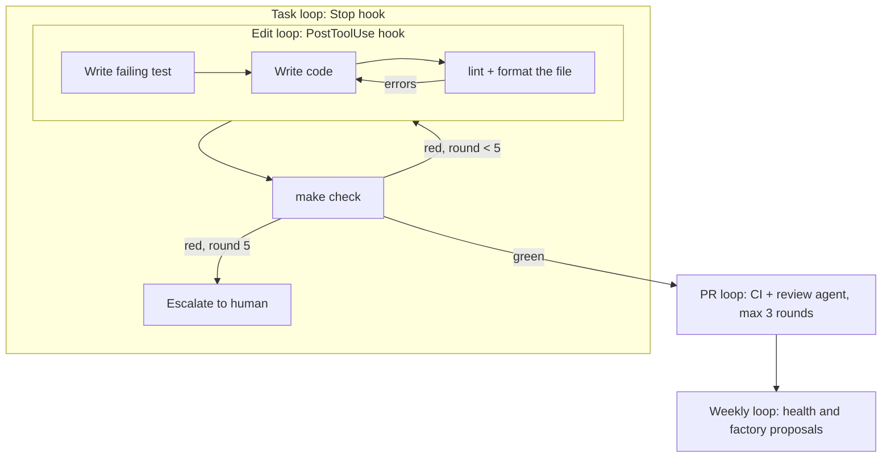

# Loops, hooks and checks

The factory gets reliable output from agents by putting them in loops whose exit condition is deterministic. An LLM decides how to fix something; a script decides whether it is fixed.

## The loops

| Loop | Runs | Exit condition | Escalation |
| --- | --- | --- | --- |
| Edit | after every file edit | the file lints and formats clean | none needed, it is fast |
| Test | inside each task | the new test fails first, then passes | the agent writes the blocker into the task |
| Task | when the agent wants to stop | `make check` green | after 5 rounds (`DSF_MAX_STOP_ROUNDS`) the hook stops blocking and tells the human |
| PR | on each push | CI green, review agent has no blocking findings | after 3 review rounds the human decides |
| Weekly | Monday via GitHub Actions | proposals reviewed | the human decides every proposal |

## Claude Code hooks

Configured in `.dsf/settings/base.json`, code in `.claude/hooks/`. All are Node scripts reading the hook JSON on stdin; exit code 2 blocks and shows the reason to the agent.

| Event | Script | What it does |
| --- | --- | --- |
| SessionStart | `session-start.mjs` | Prints mode, protected paths, app settings, modules, ADRs and the last health summary, so every session starts with the same picture. |
| UserPromptSubmit | `prompt-router.mjs` | Names the workflow that fits the request (bugfix, feature, exploration, factory). Never blocks. |
| PreToolUse Edit/Write | `protect-paths.mjs` | Refuses edits to paths the current mode protects (see modes in [usage.md](usage.md)). |
| PreToolUse Bash | `guard-bash.mjs` | Refuses `--no-verify`, force pushes, pushes to `main`, changing `core.hooksPath`, `reset --hard`, `clean -f`, hook-disabling variables, and shell writes to protected paths. |
| PostToolUse Edit/Write | `post-edit.mjs` | Runs `make lint-file-stack FILE=...` on the edited file; errors go straight back to the agent. |
| Stop, SubagentStop | `stop-check.mjs` | Runs `make check`; blocks the stop with the failing output, at most 5 rounds per session. Skips when nothing changed since the last green run. |
| PreCompact | `pre-compact.mjs` | Saves a snapshot (task, branch, changed files) that SessionStart re-reads after compaction. |
| SessionEnd | `session-end.mjs` | Appends a session record to `factory/logs/sessions.jsonl`: blocks, rounds, escalations. This is the evidence `dsf-factory-improve` learns from. |

`permissions.deny` in the same file adds a second line of defence for force pushes and `--no-verify`.

## Git hooks

`core.hooksPath` is `.dsf/githooks`, set by `cloneForApplication.sh`.

- **pre-commit:** refuses commits that mix factory files and app files (so generic fixes can be contributed); checks generated settings are current; runs gitleaks when installed; runs `make precommit` (fast checks on staged files).
- **commit-msg:** requires a type prefix (`feat:`, `fix:`, `spec:`, `arch:`, `dsf:` and so on).

### Why pre-commit hooks: yes, but small

Yes, because they are the only check that also covers humans and agents working outside Claude Code, and because a mixed commit or a leaked secret is cheaper to stop before it exists. Small, because a slow pre-commit hook trains people to skip it. The heavy checks (`make check`) run in the Stop hook and in CI, where their cost does not interrupt anyone. Agents cannot skip the git hooks: `--no-verify` is denied.

## Settings layering

`scripts/dsf/build-settings.mjs` merges `.dsf/settings/{base,workflow,app}.json` into `.claude/settings.json`: objects deep-merge, arrays concatenate without duplicates. `make settings` rebuilds it, `make check` fails when it is stale, and `make sync-pull` rebuilds it after a merge. Personal settings go in `.claude/settings.local.json`, which git ignores.
