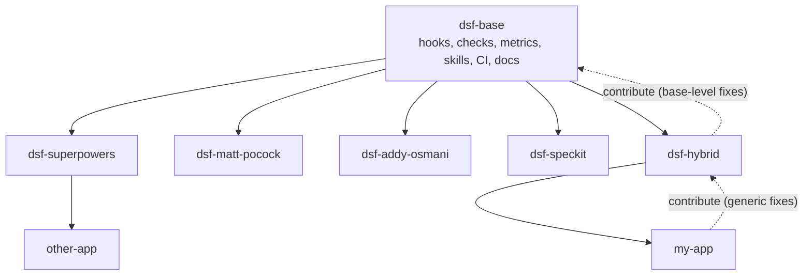

# Intended usage

## Three levels, one history



| Level | Holds | Parent remote | Ownership file | Marker |
| --- | --- | --- | --- | --- |
| dsf-base | everything common: hooks, rules, metrics, skills, CI, docs, the clone script | none | `base.paths` lists what base owns | none |
| dsf-&lt;workflow&gt; | base plus one skill pack's settings, mapping and docs | `base` | `base.paths` | `.dsf.layer` |
| application | its workflow repo plus specs, code, tests, architecture, tasks | `dsf` | `dsf.paths` lists what the factory owns | `.dsf.app` |

All three share git history: a workflow repo is dsf-base plus commits, an app is its workflow repo plus commits. That is why updates merge cleanly downward and generic fixes can be cherry-picked upward.

## Day to day in an application

```bash
make design     # specs, interviews, architecture; src/ is read-only
make build      # tests and code; specs/, uat/features/, docs/architecture/ are read-only
make factory    # improve skills, hooks, rules; app code is read-only
make check      # what the Stop hook and CI run
```

The mode is separation of duties: the agent that writes the code cannot also quietly change the spec or the architecture it is judged against.

Modes are defined in `.dsf/modes.json` (from dsf-base). A workflow repo can add `protect` or `allow` entries per mode in `.dsf/modes.workflow.json`, and an app in `.dsf/modes.app.json`; for example dsf-speckit allows build mode to tick off `specs/*/tasks.md`. A pattern ending in `/` covers a folder, `*` matches inside one path segment.

## Improvements flow up, updates flow down

- **Down:** `make sync-pull` (or the weekly `dsf-sync` PR) merges the parent's `main`. Files marked `=` in the ownership file (README, CODEOWNERS, `.gitignore`, settings) keep the local version.
- **Up:** commit generic factory changes **separately** from app changes (the pre-commit hook refuses mixed commits), then `make contribute TOPIC=short-name`. It cherry-picks the factory-only commits onto the parent's `main`, pushes `contrib/<app>/<topic>` to the parent and opens a PR there.
- From a workflow repo the same commands talk to dsf-base. A fix made in an app that belongs in dsf-base goes up in two hops: app → workflow repo, then workflow repo → base.
- `make sync-status` shows both directions: parent commits not merged yet, and local commits marked `up` (can be contributed), `own` or `mixed`.

## Where maintenance happens

Either place works, because the mechanism is symmetrical:

- In the parent: improve, merge, then every app picks it up on its next sync.
- In an app: improve while building, keep `make check` green, contribute back.

## What a workflow repo adds

A workflow repo owns only a few files on top of dsf-base (everything else is listed in `base.paths`):

- `README.md`, `.dsf.layer`, `docs/workflow/`
- `.dsf/CLAUDE.workflow.md`: which skill-pack command to use in each workflow step
- `.dsf/settings/workflow.json`: the skill-pack plugins
- `.dsf/modes.workflow.json` (optional): mode exceptions the pack needs
- `.dsf/templates/workflow-app/` (optional): files every new app of this workflow starts with; they take precedence over the base app templates
- anything the pack installs into the repo itself (for example `.specify/` for Spec Kit)

`scripts/dsf/new-workflow.sh <name>` creates a new workflow repo from an empty one.

## Settings layers

`.claude/settings.json` is generated; never edit it by hand. `make settings` merges:

1. `.dsf/settings/base.json` (hooks and denies, from dsf-base)
2. `.dsf/settings/workflow.json` (skill-pack plugins, from the workflow repo)
3. `.dsf/settings/app.json` (the app's own additions)

Objects merge deeply, lists are concatenated without duplicates. `CLAUDE.md` is layered the same way through imports: `.dsf/CLAUDE.dsf.md`, `.dsf/CLAUDE.workflow.md`, `CLAUDE.app.md`.
