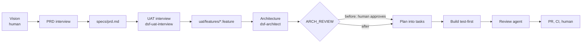

# Workflows

The prompt hook names the workflow that fits each request; the agent follows that section here. `.dsf/CLAUDE.workflow.md` in each dsf-* repo maps every step to its skill pack's commands, so the steps stay the same while the tools differ.

## bugfix

Mode: build. Human involvement: approve the PR.

1. Find the spec section or UAT scenario the bug breaks. If none covers it, the spec is missing something: add a task for design mode and continue with the fix.
2. Write a failing test that reproduces the bug at the lowest level that shows it (unit before component before integration).
3. Fix the code until the test passes. Keep the fix small; refactor in a separate commit.
4. `make check` (the Stop hook runs it anyway).
5. PR `fix: ...` linked to the task; the review agent checks it.
6. If the same kind of bug appeared before, note the rule that would have caught it in the task (`dsf-factory-improve` picks these up).

## feature

Modes: design, then build. Human involvement: vision, interview answers, architecture review, PR approval.

1. **Vision** (human): `specs/vision.md`, one page: problem, users, goals, non-goals.
2. **PRD interview** (design): the agent interviews the human one question at a time and writes `specs/prd.md` with numbered requirements.
3. **UAT interview** (design, `dsf-uat-interview`): concrete examples per requirement, written as Gherkin in `uat/features/`. These are the acceptance contract.
4. **Architecture** (design, `dsf-architect`): ASRs, modules, ADRs, diagrams, generated module rules.
5. **Architecture review**: with `ARCH_REVIEW=before` the human approves the architecture PR before any build task starts; with `after` the build continues and the human reviews the merged result in the weekly digest.
6. **Plan**: vertical-slice tasks in the task backend, each linking spec section and scenarios.
7. **Build** (build mode): per task, failing test first, then code. UAT step definitions in `uat/steps/` make the scenarios executable. Unit, component and integration tests sit next to the code.
8. **Review**: the `dsf-code-reviewer` agent, then CI, then the human.

## exploration

Modes: design (or build on a spike branch). Human involvement: the decision.

1. Write the question and the decision it informs in `docs/architecture/proposals/NNNN-topic.md` (template `.dsf/templates/proposal.md`).
2. Research: options, prior art, constraints, cost. Cite sources.
3. Prototype on a `spike/<topic>` branch. Checks may be relaxed there; spikes are never merged.
4. Write findings, options with trade-offs, and a recommendation into the proposal.
5. The human decides; the decision becomes an ADR and, if it is a go, a feature.

## factory

Mode: factory. Human involvement: approve the PR.

- Improving rules, hooks, skills or CI: `dsf-factory-improve`.
- Sending generic improvements to the parent: `dsf-contribute` (`make contribute TOPIC=...`).
- Rebuilding the app with a different architecture: `dsf-rebuild`, see [rebuild.md](rebuild.md).
