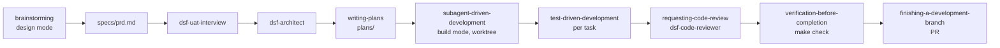

# dsf-superpowers workflow

This factory uses [Superpowers](https://github.com/obra/superpowers) by Jesse Vincent: a skill library that makes the agent brainstorm before building, write a plan before coding, work test-first, and verify before claiming success. Its skills trigger on their own when the situation matches, so the process happens without the human typing commands.

## How a feature flows

1. `make design`, then describe the feature. `brainstorming` asks questions one at a time and proposes two or three approaches; the result is saved to `specs/`.
2. Run the UAT interview and architecture steps (`dsf-uat-interview`, `dsf-architect`).
3. `writing-plans` breaks the work into small steps with exact files, tests and commands, saved in `plans/`.
4. `make build`, then ask to execute the plan. `subagent-driven-development` gives each step to a fresh subagent and reviews it between steps; every step follows red, green, refactor.
5. `verification-before-completion` runs `make check` before anything is called done; the Stop hook enforces the same.
6. `finishing-a-development-branch` opens the PR.

Full step-to-skill mapping: [.dsf/CLAUDE.workflow.md](../../.dsf/CLAUDE.workflow.md).

## Strengths and weaknesses

| Strengths | Weaknesses |
| --- | --- |
| The strictest TDD discipline of the packs; the agent deletes code written before its test. | Little help with requirements beyond brainstorming; no PRD or ticket format of its own. |
| Subagent per task keeps context small and gives built-in review between tasks. | No architecture skills; the factory's `dsf-architect` fills the gap. |
| Skills trigger automatically, so less for the human to remember. | Uses more tokens than a single-agent flow. |

## Installing and upgrading

Claude Code offers to install the plugin the first time it starts in the repo (from `.dsf/settings/workflow.json`). Upgrade with `/plugin` → Marketplaces → update, then run the factory benchmark ([docs/dsf/factory-evolution.md](../dsf/factory-evolution.md#benchmark)) before relying on the new version.
